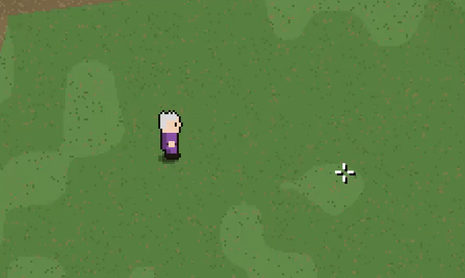

# Лес Эхо: Исаакнутый — локальная кооперативная RPG

Пиксельная браузерная RPG на Python/FastAPI для игры по локальной сети, стилизованная под игры серий The Binding Of Isaac. Сервер ведёт общий мир, монстров, ресурсы, экипировку, сохранения персонажей и чат.


## Аккаунты и вход

При первом запуске выберите «Регистрация», задайте имя пользователя и пароль (от 8 символов) и повторите пароль. Для следующих входов используйте вкладку «Вход». Пароли хранятся как PBKDF2-HMAC-SHA256 хеши с уникальной случайной солью; открытый пароль в SQLite не сохраняется. Сессия хранится в защищённой HTTP-only cookie и отзывается кнопкой «Выйти». Есть новая и легаси страница входа (см. static)

Пользовательские аккаунты и сохранения персонажей хранятся в локальной SQLite-базе `echo_saves.sqlite3`. Резервируйте этот файл вместе с проектом. Восстановления пароля через почту нет: не теряйте пароль. Для игры через интернет обязательно настройте HTTPS; cookie автоматически получает флаг Secure на HTTPS. Можно также войти через Legacy страницу.


## Запуск

Нужен Python 3.10 или новее.

```bash
python -m venv .venv
# Windows: .venv\Scripts\activate
# macOS / Linux: source .venv/bin/activate
python -m pip install -r requirements.txt
python server.py
```

На компьютере-хосте откройте http://localhost:8000. Друг подключается к `http://ЛОКАЛЬНЫЙ_IP_ХОСТА:8000` (например, адрес из `ipconfig` в Windows). Разрешите Python входящие подключения в брандмауэре. Сервер слушает все сетевые интерфейсы (0.0.0.0)

Персонаж сохраняется в SQLite-файл `echo_saves.sqlite3` рядом с сервером. Используйте разные имена персонажей для разных игроков.

## Управление

- WASD / стрелки — движение.
- Левая кнопка мыши — удерживать для замаха, отпустить для удара (удерживание дает дополнительный урон, но если часто нажимать ЛКМ - тройное комбо отдалит врага от игрока)
- Наведение мыши задаёт направление удара и перемещение камеры

- E — собирать ресурс поблизости; F — говорить с Хранителем; Q — выпить настойку.
- Первое подключение персонажа получает 150 стартовых монет.

- Shift — бег и Space - уклонение; ` — инвентарь и крафт; M — большая карта; Enter — чат (ESC для выхода из ввода).
- 1-9 или скролл — быстрый выбор.



## Содержимое

Девять регионов возрастающей сложности: лагерь, лес, топи, руины, Хребет Синего Пламени, Разлом Эха, Астральная Бездна, Обсидиановый край и Первозданный сад. В последних землях появились новые боссы, редкие доспехи и оружие.

Большая карта открывается клавишей M и показывает все регионы, дорогу, мобов, ресурсы и игроков. Инвентарь обновляется по состоянию сервера; кнопка экипировки отправляет команду и сервер подтверждает результат в чате/уведомлении.

PvP доступно только вне безопасного лагеря. Игроки получают сниженный урон с учётом защиты; при нуле здоровья персонаж возвращается в лагерь через пять секунд. Безопасная зона блокирует и ближние атаки по игрокам, и стрелы.

## Спрайты игрока (8 направлений)

Шаблон: фигура 17×26 с чёрным контуром и белыми глазами. Весь персонаж собирается слоями в `static/js/player.js` и запекается один раз на (облик, направление, кадр).

- **Направления:** E, SE, S, SW, W, NW, N, NE. Рисуются 5 видов (S, SE, E, NE, N), остальные три зеркалятся. Направление берётся из прицела.
- **Облик** (13 параметров, выдаёт сервер при каждом входе и возрождении, `SKIN_PARTS` в `server.py`): тон кожи ×8, цвет волос ×10, причёска ×8 (лысый, короткая, шипы, длинные, хвост, пучок, ирокез, афро), борода ×4, верх одежды ×6 (туника, рубаха, жилет, роба, броня, комбинезон) и его цвет ×12, низ ×3 и цвет ×10, обувь ×3 и цвет ×6, головной убор ×7 (шапка, колпак, шлем, корона, капюшон, бандана) и цвет ×10, отделка ×8.
- **Анимация:** idle — дыхание (грудь и голова поднимаются на пиксель, руки чуть расходятся, хвост качается), раз в ~8 с взгляд влево-вправо, моргание в случайные моменты, у каждого игрока своя фаза. Ходьба — 6 кадров, темп зависит от скорости (бег быстрее).
- Превью и листы спрайтов в родном размере — в папке `sprite_preview` рядом с архивом.

## Управление с телефона и планшета

Сенсорный режим включается сам на устройствах с сенсорным экраном (или при первом касании). Его можно переключить вручную: **Меню → Сенсорное управление: авто / вкл / выкл**. Играть лучше в горизонтальной ориентации.

| Что | Как |
|---|---|
| Движение | Левая половина экрана: коснись и веди пальцем (плавающий джойстик). Лёгкий нажим — шаг, дальше кольца — бег |
| Удар | Кнопка «Удар»: удерживать — замах, отпустить — удар. Быстрый тап — быстрый удар |
| Прицел | Не отпуская «Удар», веди пальцем в нужную сторону. Без прицела персонаж бьёт ближайшего врага, а вне боя смотрит по ходу движения |
| Рывок / Лечение | Кнопки «Рывок» и «Лечение» (на значке — число настоек) |
| Действие | Загорается рядом с ресурсом («Собрать», повторное нажатие — «Стоп») или Хранителем («Говорить») |
| Инвентарь, карта, чат, меню | Ряд кнопок сверху по центру. Все окна закрываются кнопкой «Закрыть» |
| Предметы | Нажми на предмет, чтобы взять; кнопки «Надеть» / «В руки» / «Выпить» или долгое нажатие. Слот панели выбирается тапом |
| Чат | Кнопка «Чат»: поле ввода уходит наверх, чтобы клавиатура его не закрывала |

Особенности: размеры интерфейса на сенсорном экране считаются отдельно от размера игрового пикселя (слоты хотбара ≥ ~35 px), учитываются вырезы экрана (`safe-area`), эмулированные браузером события мыши не вызывают ударов, мышь на гибридных устройствах продолжает работать. Кнопка «Полный экран» есть в меню (на iPhone Safari этот режим не поддерживается).
